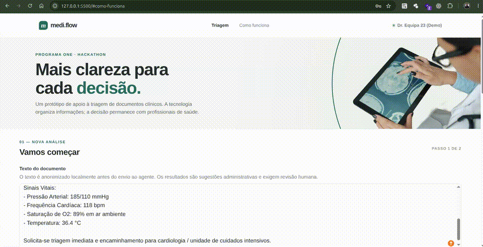
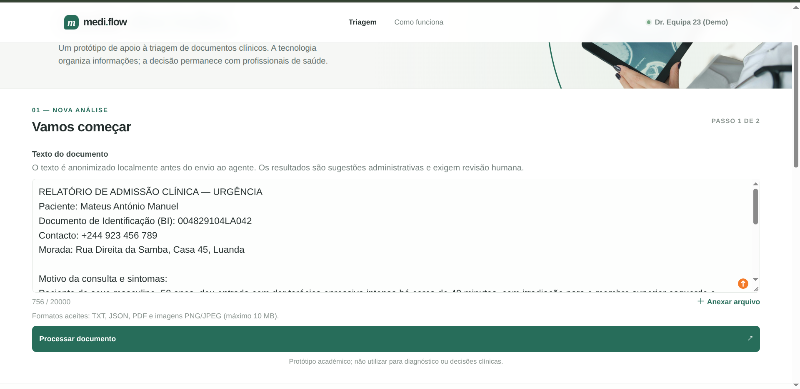
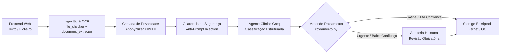

<div align="center">
  
  <h1>MediFlow — Triagem Clínica Inteligente & Auditoria Humana</h1>
  <p><strong>Hackathon Alura / Oracle ONE (G10 LATAM) — Equipa 23</strong></p>

  <p>
    <a href="https://SEU-LINK-DO-NETLIFY.netlify.app" target="_blank">
      
    </a>
    
    
    
    
  </p>
</div>

## Links do Projeto

* **Aplicação Web (Frontend — Netlify):** [https://g10-latam-equipo-23-mediflow.netlify.app](https://g10-latam-equipo-23-mediflow.netlify.app)
* **API & Documentação Swagger (Backend — Render):** [https://SEU-LINK-DO-RENDER.onrender.com](https://mediflow-backend-eq23.onrender.com)]
* **Repositório Oficial:** [github.com/Israzuba0023/G10-LATAM-equipo-23-Mediflow](https://github.com/No-Country-simulation/G10-LATAM-equipo-23-Mediflow)
---

## Sobre o Projeto

O **MediFlow** é uma plataforma de apoio à triagem documental e encaminhamento administrativo clínico desenvolvida para otimizar o fluxo de admissão em unidades de saúde. A aplicação recebe relatos clínicos não estruturados (texto livre ou ficheiros `PDF`, `PNG`, `JPEG`, `TXT` e `JSON`), executa anonimização local de dados sensíveis antes de qualquer comunicação externa, aplica guardrails contra manipulação de instruções e utiliza um **Agente de IA (via Groq)** para classificar prioridades, sugerir especialidades médicas e encaminhar casos críticos ou ambíguos para **Auditoria Humana (*Human-in-the-Loop*)**.

---

## Demonstração em Vídeo


---

## Capturas de Ecrã

| Submissão e Anonimização Local | Painel de Triagem & Predição do Agente |
| :---: | :---: |
|  |  |

---

## Arquitetura do Sistema e Fluxo do Agente

O sistema foi desenhado sob uma arquitetura modular desacoplada (*Frontend Estático* + *API REST FastAPI*), operando com um pipeline defensivo em 5 etapas:



---

## Detalhamento das Camadas do Projeto

### 1. Backend (`backend/app/`)

Construído em **Python** com **FastAPI**, responsável pela orquestração do agente, extração multimodal, validação de esquemas e persistência:

* **`main.py`:** Ponto de entrada da API REST, gestão de CORS, healthcheck (`/health`) e exposição dos endpoints de triagem (`/api/v1/triage/text` e `/api/v1/triage/file`).
* **`document_extractor.py`:** Motor de extração multimodal capaz de ler texto puro (`TXT`, `JSON`), documentos `PDF` e aplicar reconhecimento ótico de caracteres (`Tesseract OCR`) em imagens (`PNG`, `JPEG`).
* **`agent/Agente.py`:** Núcleo cognitivo que comunica com a **Groq API**, enviando exclusivamente o texto já anonimizado e exigindo saída estruturada com prioridade sugerida, especialidade recomendada, resumo clínico e índice de confiança.
* **`agent/roteamento.py`:** Lógica de decisão que encaminha automaticamente ocorrências de alta gravidade ou baixa confiança para a fila de **`auditoria_humana`**, impedindo decisões autónomas sem supervisão profissional.
* **`schemas/schemas.py`:** Contratos rigorosos em **Pydantic** que validam tanto os dados de entrada quanto o JSON devolvido pelo modelo de linguagem.
* **`storage/object_storage.py`:** Camada de persistência com suporte a armazenamento local encriptado (Fernet) e integração com **Oracle Cloud Infrastructure (OCI Object Storage)**.

### 2. Segurança e Privacidade (`backend/app/security/` & `auth/`)

Implementada sob o princípio *Privacy & Safety by Design* para proteger dados sensíveis (PII/PHI) e mitigar vulnerabilidades de IA:

* **`security/anonymizer.py`:** Sanitização local antes da chamada à LLM. Aplica padrões híbridos (Regex + NER com fallback automático) para mascarar nomes de pacientes, documentos de identificação (BI/CPF), contactos telefónicos, e-mails e moradas.
* **`security/guardrails.py`:** Barreira defensiva contra ataques de *Prompt Injection* escondidos em documentos clínicos e validação de integridade semântica da resposta do agente.
* **`security/file_checker.py`:** Inspeção de assinaturas de ficheiro (*magic bytes*), validação de extensões permitidas e bloqueio de ficheiros acima de 10 MB.
* **`security/logging_filter.py`:** Filtro de registos que impede a gravação de dados sensíveis ou tokens nos logs do servidor.
* **`auth/security.py` & `auth/setup.py`:** Estrutura de controlo de acesso baseada em perfis (Operador / Médico Auditor) com suporte a JWT e modo de demonstração configurável para ambiente académico.

### 3. Frontend (`frontend/`)

Interface leve, responsiva e sem dependências pesadas, desenvolvida em **HTML5**, **CSS3** e **JavaScript Vanilla**:

* **`index.html`:** Estrutura semântica dividida em área de submissão (texto livre ou upload com drag-and-drop) e **Painel de Triagem** com indicadores visuais de prioridade, confiança, estado de anonimização e fila de auditoria.
* **`styles.css`:** Design limpo focado em legibilidade clínica, hierarquia visual de alertas e responsividade para desktop e dispositivos móveis.
* **`script.js`:** Gestão assíncrona das requisições `fetch` para a API, feedback de estado em tempo real e renderização dinâmica dos resultados.
* **`config.js`:** Ficheiro de configuração de ambiente que alterna automaticamente entre `[http://127.0.0.1:8000](http://127.0.0.1:8000)` (desenvolvimento local) e `window.MEDIFLOW_API_URL` (produção no Render/Netlify).

---

## Estrutura de Diretórios

```text
G10-LATAM-equipo-23-Mediflow/
├── backend/
│   ├── app/
│   │   ├── agent/                  # Agente LLM (Agente.py) e roteamento (roteamento.py)
│   │   ├── auth/                   # Gestão de perfis e autenticação
│   │   ├── schemas/                # Modelos de dados Pydantic
│   │   ├── security/               # Anonymizer, Guardrails, File Checker e Log Filter
│   │   ├── storage/                # Persistência local encriptada e OCI Storage
│   │   ├── document_extractor.py   # Extração de texto e OCR multimodal
│   │   └── main.py                 # Aplicação FastAPI e rotas REST
│   ├── tests/                      # Testes automatizados da API
│   ├── Procfile                    # Comando de arranque para Render
│   └── requirements.txt            # Dependências Python
├── frontend/
│   ├── assets/                     # Ilustrações e ícones
│   ├── config.js                   # Endpoint dinâmico da API
│   ├── favicon.svg                 # Identidade visual
│   ├── index.html                  # Interface principal
│   ├── script.js                   # Integração com Backend
│   └── styles.css                  # Folha de estilos
├── docs/
│   └── media/                      # Vídeo demonstrativo e capturas de ecrã
├── netlify.toml                    # Configuração de publicação do Frontend
└── README.md                       # Documentação do projeto
```

---

## Como Executar Localmente

### Pré-requisitos

* **Python 3.10+**
* **Tesseract OCR** instalado no sistema (`tesseract-ocr` com pacotes `por` e `eng`)
* Chave de API ativa na [Groq Cloud](https://console.groq.com/)

### 1. Iniciar o Backend (FastAPI)

```bash
cd backend
python3 -m venv .venv
source .venv/bin/activate
pip install -r requirements.txt
cp ../.env.example .env
# Adicione a sua GROQ_API_KEY no ficheiro .env
python3 -m uvicorn app.main:app --host 127.0.0.1 --port 8000
```

### 2. Iniciar o Frontend

Noutro terminal, na raiz do projeto:

```bash
cd frontend
python3 -m http.server 5500 --bind 127.0.0.1
```

Aceda no navegador a **`[http://127.0.0.1:5500](http://127.0.0.1:5500)`**.

---

## Equipa 23 — Hackathon ONE (G10 LATAM)

Projeto idealizado e desenvolvido pelo **Grupo 23**:

| Integrante | LinkedIn |
| :--- | :--- |
| **Israel Cassute** | [linkedin.com/in/israel-cassute](https://www.linkedin.com/in/israel-cassute/) |
| **Matheus Nunes** | [linkedin.com/in/matheus-nunes-a02769431](https://www.linkedin.com/in/matheus-nunes-a02769431/) |
| **Rafael Silva** | — |
| **Samuel Vaz** | — |

---

*Protótipo académico desenvolvido no âmbito do Hackathon Alura / Oracle Next Education (ONE) — Grupo 23.*
