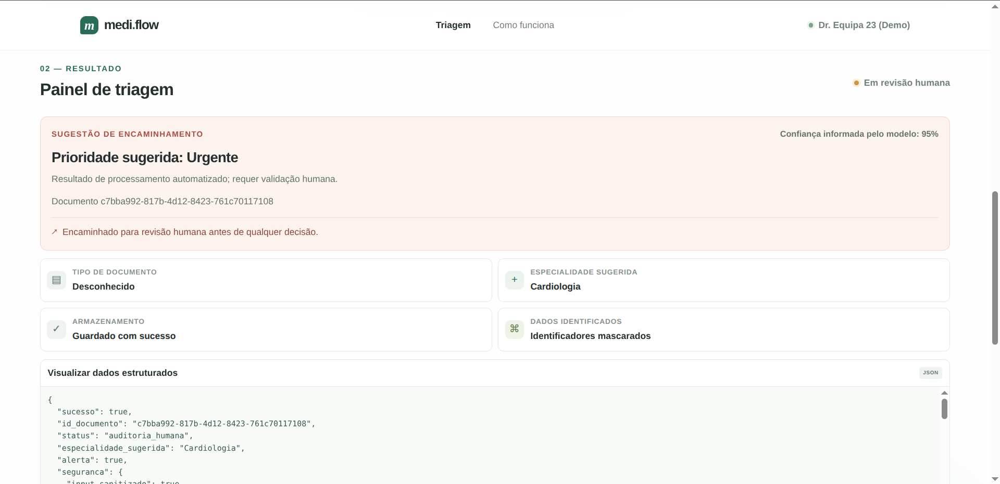

# MediFlow — Triagem Clínica Inteligente & Auditoria Humana

**Protótipo Académico — Hackathon ONE | Grupo 23**

O MediFlow demonstra extração e organização de documentos para encaminhamento
administrativo com revisão humana. É um protótipo académico, não um dispositivo
médico: os resultados não são diagnósticos nem substituem avaliação profissional.
Use apenas documentos fictícios ou sintéticos.

## Demonstração em Vídeo

Vídeo: [`docs/media/demo-mediflow.mp4`](docs/media/demo-mediflow.mp4)

<!-- Substituir pelo vídeo carregado no GitHub para apresentar o embed no README. -->
<video src="docs/media/demo-mediflow.mp4" controls width="720">
  O seu navegador não suporta vídeo incorporado.
</video>

## Capturas de Ecrã

| Ecrã | Captura |
|---|---|
| Triagem |  |
| Painel de resultado |  |

## Funcionalidades Principais

- **Extração multimodal:** `backend/app/document_extractor.py` extrai texto de
  TXT, JSON, PDF e imagens PNG/JPEG, usando OCR local quando necessário.
- **Anonimização local PII/PHI:** `backend/app/security/anonymizer.py` aplica
  padrões Regex e NER local quando disponível; sem NER, continua com Regex.
  A deteção é probabilística e não garante remoção de todos os identificadores.
- **Guardrails contra Prompt Injection:** `backend/app/security/guardrails.py`
  valida as entradas e a saída estruturada do agente.
- **Agente via Groq:** `backend/app/agent/Agente.py` envia o conteúdo mascarado
  à API Groq e valida a resposta com o esquema da aplicação. Requer `GROQ_API_KEY`.
- **Fluxo de auditoria humana:** os resultados são encaminhados para
  `auditoria_humana` para revisão; o agente não aprova decisões clínicas.
- **Armazenamento seguro:** `backend/app/storage/object_storage.py` suporta
  armazenamento local com criptografia Fernet e integração OCI configurável.
  Proteja e persista a chave de encriptação fora do código.

## Arquitetura do Projeto

```text
.
├── backend/
│   ├── app/
│   │   ├── agent/                 # Agente Groq e regras de encaminhamento
│   │   ├── auth/                  # Autenticação e autorização
│   │   ├── security/              # Anonimização, validação e guardrails
│   │   ├── storage/               # Armazenamento local/OCI
│   │   ├── document_extractor.py  # Extração de texto e OCR
│   │   └── main.py                # API FastAPI
│   ├── requirements.txt
│   └── Procfile
├── frontend/                      # Interface estática HTML/CSS/JavaScript
├── docs/
│   └── media/                     # Vídeo e capturas para a apresentação
└── netlify.toml                   # Publicação do frontend no Netlify
```

## Execução Local

Requisitos: Python 3.10+ e Tesseract OCR com os idiomas português e inglês.

1. Instale as dependências e configure as variáveis locais:

   ```bash
   python3 -m venv .venv
   source .venv/bin/activate
   pip install -r backend/requirements.txt
   cp .env.example .env
   ```

2. Configure em `backend/.env` ou no `.env` da raiz as credenciais e chaves
   necessárias, incluindo `GROQ_API_KEY`, `MEDIFLOW_AUTH_SECRET` e
   `STORAGE_ENCRYPTION_KEY`. Nunca publique estes valores.

3. Inicie a API:

   ```bash
   cd backend
   python -m uvicorn app.main:app --host 127.0.0.1 --port 8000
   ```

4. Noutro terminal, sirva a interface:

   ```bash
   cd frontend
   python3 -m http.server 5500 --bind 127.0.0.1
   ```

5. Abra <http://127.0.0.1:5500>. Em localhost, a interface usa o modo de
   demonstração local. O healthcheck da API está disponível em
   <http://127.0.0.1:8000/health>.

## Deploy: Render e Netlify

### Backend no Render

Crie um Web Service a partir do repositório, defina **Root Directory** como
`backend`, instale com `pip install -r requirements.txt` e use o comando de
inicialização do `Procfile`. Configure as variáveis secretas no painel do Render:
`GROQ_API_KEY`, `MEDIFLOW_AUTH_SECRET`, `STORAGE_ENCRYPTION_KEY` e
`ALLOWED_ORIGINS` com o domínio HTTPS do frontend Netlify. Defina
`MEDIFLOW_LOCAL_DEMO_MODE=false` fora do desenvolvimento local.

Configure armazenamento persistente para a base SQLite e os documentos locais,
ou use OCI Object Storage. O disco efémero padrão do Render não é adequado para
guardar dados que precisem persistir entre reinícios. Antes de publicar, valide
o bootstrap de contas para o ambiente remoto e restrinja CORS aos domínios
confiáveis.

### Frontend no Netlify

Importe o mesmo repositório no Netlify. O ficheiro `netlify.toml` publica a
pasta `frontend` e encaminha rotas estáticas para `index.html`. Em
`frontend/config.js`, defina `window.MEDIFLOW_API_URL` como a origem HTTPS do
serviço Render, sem segredo. Configure o mesmo domínio Netlify em
`ALLOWED_ORIGINS` no Render.

## Segurança e Privacidade

O mascaramento Regex/NER não equivale a desidentificação certificada. O texto
mascarado é enviado a um provedor externo quando o agente é usado. Não introduza
dados reais de pacientes neste protótipo. A implantação requer revisão de
segurança, privacidade, autenticação, retenção e gestão de chaves adequada ao
ambiente e às regras aplicáveis.

O modo de demonstração local atribui uma identidade privilegiada sem JWT e deve
permanecer desativado em produção. Não exponha a API local à Internet.
